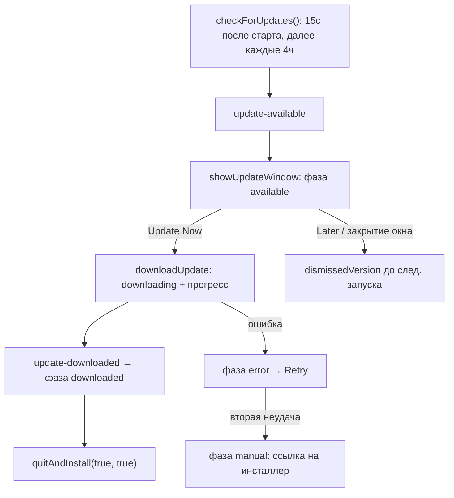

# Автообновление приложения

Обновление построено на `electron-updater` и generic-провайдере: приложение
периодически опрашивает статический фид (`latest.yml` / `latest-mac.yml` /
`latest-linux.yml` / `beta*.yml`) на `https://officevega.com/updates/`,
скачивает инсталлер целиком и устанавливает его перезапуском. Реализовано два
варианта UX: модальное окно обновления в shell
(`apps/shell/src/main/updater.ts`) и тихая фоновая загрузка с нативным
диалогом в standalone Docs (`apps/docs/src/main/updater.ts`).

## Публикация и конфигурация

- URL фида зашивается в `resources/app-update.yml` на этапе сборки: блок
  `publish` в `apps/shell/electron-builder.cjs` (provider `generic`,
  `channel: 'latest'`) добавляется только если задана переменная окружения
  `OFFICEVEGA_UPDATE_URL`. Локально её читает electron-builder из
  `apps/shell/electron-builder.env` (файл в gitignore), в CI — из секретов.
  Без переменной publish-конфиг не эмитится, `app-update.yml` в пакет не
  попадает и автообновление в сборке отключено.
- Платформы: Windows — NSIS (`latest.yml`, x64 и опционально arm64 через
  `OFFICEVEGA_WIN_ARM64=1`); macOS — zip + Squirrel.Mac (`latest-mac.yml`,
  arm64, x64 опционально через `OFFICEVEGA_MAC_X64=1`); Linux — только
  AppImage (`latest-linux.yml`). deb и rpm самообновления не имеют:
  deb обновляется вручную через `apt install ./<new>.deb`, rpm — через
  `dnf install ./<new>.rpm`; rpm вообще исключён из фида (`publish: null`
  в конфиге rpm-таргета).
- Каналы `stable` и `beta`: `CHANNEL_FEED` мапит их на `latest` / `beta`,
  платформенный суффикс (`-mac`, `-linux`) electron-updater добавляет сам.
  `allowDowngrade` принудительно выключен после каждой установки
  `autoUpdater.channel` (сеттер electron-updater сам включает его обратно) —
  переход beta→stable не должен откатывать версию.
- Выбор канала живёт в Настройках → «Канал обновлений»: IPC
  `home:get-update-channel` / `home:set-update-channel` (index.ts) пишет
  `updateChannel` в `app-settings.json` и вызывает `applyUpdateChannel`,
  который переключает фид на лету и сразу запускает проверку.

## Сборка и заливка фида

- `node scripts/stage-update-feed.cjs [srcDir ...] [--out dir] [--force]`
  собирает каталог `release-feed/` из `apps/shell/release/` (или из
  нескольких переданных папок — объединяет same-name `latest*.yml` /
  `beta*.yml` отдельных arch-проходов, например win x64 + win arm64). Копирует
  только файлы, перечисленные в манифестах, проверяет sha512 каждого
  инсталлера и защищает от отката (forward-only, `--force` для отката).
  Файл из манифеста, отсутствующий во всех srcDir, абортит весь прогон.
- Порядок заливки на `officevega.com/updates/`: сначала инсталлеры, в последнюю
  очередь `*.yml` — иначе клиенты увидят манифест без файлов и получат ошибку
  загрузки (само восстановится на следующей проверке через 4 часа).
- Полный runbook по хостингу фида (структура папки, кэш-заголовки,
  beta-канал, чеклист релиза, траблшутинг): `docs/update-feed-officevega.md`.

## Цикл проверки (shell)

`initAutoUpdater(getWindow, initialChannel)` вызывается из
`apps/shell/src/main/index.ts` после создания окна и работает только в
упакованной сборке (`app.isPackaged`); на Linux — только внутри AppImage
(нужен `process.env.APPIMAGE`). Настройки: `autoDownload = false`,
`autoInstallOnAppQuit = true`, `disableDifferentialDownload = true`
(`.blockmap` не публикуются). Проверки: первая через 15 секунд
(`FIRST_CHECK_DELAY_MS`), затем каждые 4 часа (`RECHECK_INTERVAL_MS`).

- На `update-available` открывается модальное безрамочное окно
  `showUpdateWindow` (`update-window.ts`, контент —
  `apps/shell/src/renderer/update.html` + `src/renderer/src/update.ts`).
  Повторная проверка той же версии не сбрасывает состояние открытого окна;
  более новая версия, пришедшая во время загрузки/после `downloaded`,
  игнорируется до конца текущего флоу (`downloadInFlight || phase ===
  'downloaded'` — старая всё равно ставится на выходе, новую подхватит
  следующий запуск).
- «Позже» и любое пользовательское закрытие окна (включая Alt+F4)
  запоминают версию в `dismissedVersion` — до конца сессии её не показывают
  повторно. `autoInstallOnAppQuit` всё равно доставит скачанное обновление
  при обычном выходе.
- Кнопки окна идут через IPC-каналы `UPDATE_CHANNELS`
  (`update:get-state`, `update:download`, `update:install`, `update:later`,
  `update:open-download`, пуш-событие `update:changed`), объявленные в
  `shared/update-api.ts`, обработанные в `update-window.ts` и проброшенные в
  renderer через preload `src/preload/update.ts` → `window.aiOfficeUpdate`.
- Установка: `quitAndInstall(true, true)` через `setImmediate` после
  закрытия окна.

## Ручная проверка (Help → Check for Updates / About)

`checkForUpdatesNow` — пользовательская проверка с явной обратной связью.
Меню Help и кнопка в диалоге About живут в `@genoffice/electron-utils`
(`checkUpdatesMenuItem`, `aboutMenuItem`); shell регистрирует обработчик
через `setUpdateCheckInvoker(() => void checkForUpdatesNow())`. Поведение:

- есть обновление — открывается то же окно (даже для версии, отклонённой
  «Later» в этой сессии — пользователь явно попросил);
- обновление уже качается/скачано — окно переоткрывается в текущей фазе
  (`phase`/`percent` сохраняются в модуле);
- нового нет — нативный диалог «У вас последняя версия ({version})»
  (`updUpToDate`);
- проверка упала — диалог `updCheckFailed`;
- апдейтер неактивен (dev-запуск, deb/rpm на Linux) — диалог `updManual` с
  кнопкой «Открыть страницу загрузки» → `DOWNLOAD_PAGE_URL`.

Параллельные вызовы дедуплицируются флагом `manualCheckInFlight`.

## Обработка ошибок и ручной fallback

- После `MANUAL_FALLBACK_AFTER = 2` неудачных попыток скачивания одной версии
  фаза меняется с `error` на `manual` — покрывает перманентно сломанные пути,
  в первую очередь смену Apple Team ID, которую Squirrel.Mac отклоняет на
  каждой попытке. Ошибка может прийти и через rejection `downloadUpdate()`,
  и только через событие `error` (Squirrel.Mac репортирует нативно) — оба
  пути сходятся в `failDownload`, флаг `downloadInFlight` дедуплицирует.
- Ссылка для ручной установки строится `manualDownloadUrlFor`: из
  `info.files[]` манифеста выбирается артефакт под платформу и
  `process.arch` (macOS — dmg, zip только для Squirrel; Windows — exe с
  учётом `-arm64` суффикса; Linux — AppImage), берётся только basename, а
  итоговый URL пересобирается относительно доверенной HTTPS-базы из
  `resources/app-update.yml` (`updateFeedBaseUrl`) — URL из удалённых
  метаданных не доверяются. Невалидная/не-HTTPS база → null.
- Если базу прочитать нельзя или файл не подобрался — используется запасная
  страница `DOWNLOAD_PAGE_URL = https://officevega.com/releases`.

## Standalone Docs

Отдельное приложение Docs вызывает `initDocsAutoUpdater` при старте
(`apps/docs/src/main/docs-main.ts`). Сценарий проще: `autoDownload = true`,
обновление качается молча, а по `update-downloaded` показывается нативный
`dialog.showMessageBox` «Перезапустить и установить / Напомнить позже»;
отказ откладывает установку до обычного выхода (`autoInstallOnAppQuit`) и
запоминает версию в `dismissedVersion`. Работает только на Windows и macOS;
standalone-сборки сейчас собираются без publish-конфига, поэтому упакованный
запуск просто логирует ошибку отсутствующего фида.

## Проверки в dev-режиме

В неупакованных запусках апдейтер не работает (`!app.isPackaged → return`),
но есть превью UI: `OFFICEVEGA_FAKE_UPDATE=<version>` запускает
`initFakeUpdate` — настоящее окно и IPC с симулированным прогрессом загрузки.
`fakeShowAgain` позволяет переоткрыть окно через «Check for Updates».
`checkForUpdatesNow` в dev-запуске без фейка показывает `updManual` со
ссылкой на страницу загрузки.

## Отличия от исходного проекта (genoffice)

- Env-переменные переименованы: `GENOFFICE_UPDATE_URL` →
  `OFFICEVEGA_UPDATE_URL`, `GENOFFICE_FAKE_UPDATE` → `OFFICEVEGA_FAKE_UPDATE`.
- Фид — собственный хост `https://officevega.com/updates/` (статическая
  раздача), а не Azure CDN; `DOWNLOAD_PAGE_URL` — `https://officevega.com/releases`
  вместо GitHub Releases.
- Добавлен `scripts/stage-update-feed.cjs` + `update-feed-utils.cjs` — сборка
  фида с sha512-верификацией, мерджем манифестов arch-проходов и forward-only
  защитой; runbook — `docs/update-feed-officevega.md`.
- Добавлена ручная проверка обновлений `checkForUpdatesNow` (пункт меню Help
  → Check for Updates и кнопка в About через `@genoffice/electron-utils`),
  с новыми i18n-ключами `updUpToDate` / `updCheckFailed`.
- Канал обновлений выбирается пользователем в настройках и хранится в
  `app-settings.json` (`updateChannel`); `applyUpdateChannel` переключает
  фид без перезапуска.
- Артефакты и идентичность ребрендированы: `com.officevega.app`,
  `OfficeVega Setup <v>.exe`, `OfficeVega-<v>.dmg/.AppImage`,
  `officevega_<v>_amd64.deb`; deb/rpm помечены `conflicts/replaces/provides:
  vegaoffice` для миграции со старого пакета.
- Linux-таргетов стало больше (deb, rpm), но самообновляется по-прежнему
  только AppImage; rpm намеренно не попадает в фид.

## Примечания

- Вся копия окна обновления локализована в main-процессе на ~28 языков
  (включая русский); в standalone Docs — ~25 языков, 5 ключей.
- Поведение manual-fallback (выбор архитектуры, пересборка URL, отказ от
  HTTP-фида) и логика каналов покрыты тестами:
  `apps/shell/tests/updater.test.ts`, `update-channel.test.ts`,
  `update-feed-utils.test.ts`, `apps/docs/tests/updater.test.ts`.
